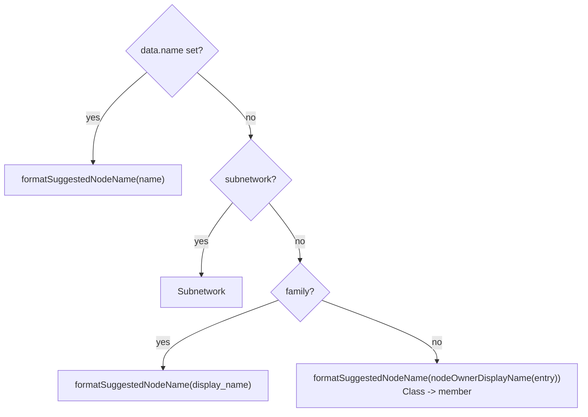
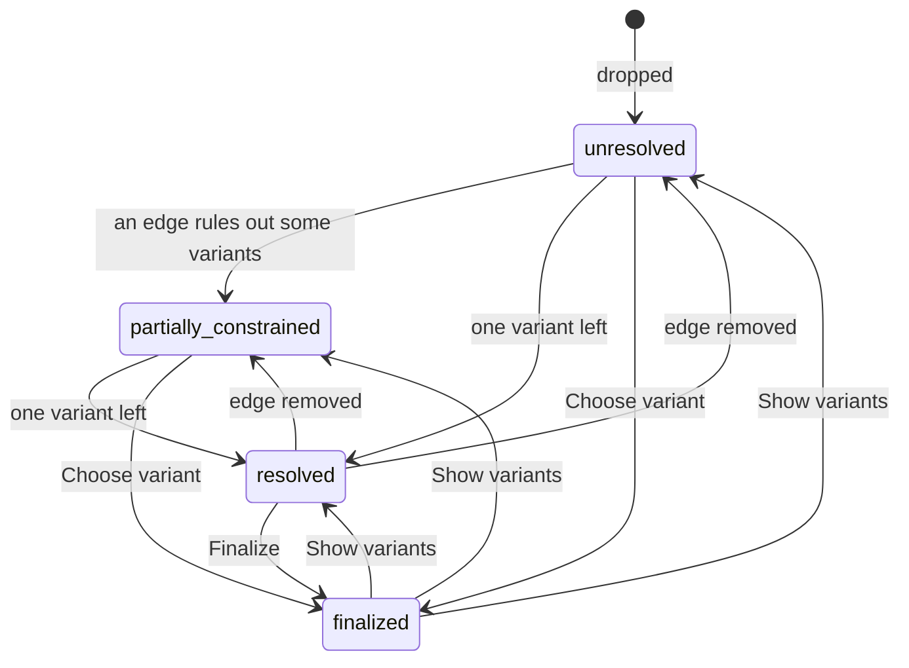
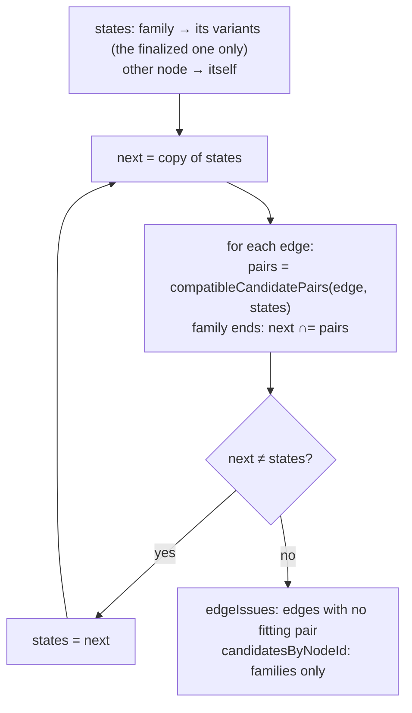

# Unified node

[UnifiedNode.svelte](../../src/lib/components/nodes/UnifiedNode.svelte) draws every node of the graph canvas except pipeline stages: concrete registry entries, literals, parameter-file nodes, subnetworks and overload families. Its border colour comes from the node type (`nodeColors` in [nodeTypes.ts](../../src/lib/types/nodeTypes.ts)), or `PARAMETER_FILE_COLOR` for a parameter-file node.

```
┌──────────────────────────────────────────────┐
│ ID 13        Weak term          [✎][ⓘ][🗑]   │  header: name, buttons
│        (5 variants) [Choose variant ▾]       │  status row, families only
├──────────────────────────────────────────────┤
●  rhs / trial_gradient / trial                │  port grid: one row per port,
│  Function<2>                                 │  inputs left, outputs right
│  Observable<2,2,Scalar,gradient>             │
│                                   output    ●│
│                             KnownTerm<2,2,…> │
├──────────────────────────────────────────────┤
│  [ value ]                                   │  literals only
└──────────────────────────────────────────────┘
```

## Header

### Name

The title is [returnNodeName](../../src/lib/graph/canvasNodeUtils.ts):



- A node dropped from the sidebar stores no `name`, so its title follows the registry until the user renames it with **Edit name**. A node created from a dragged edge stores the name picked in the connected-node list.
- [nodeOwnerDisplayName](../../src/lib/registry/nodePalette.ts) prefixes `nodePaletteDisplayName` with the class (`Class -> member`), except for constructors (including functions with `method_name: "create"`) and entries without `class_name`.
- `nodePaletteDisplayName` takes the first of: a literal's type; `display_name`; `method_name` without numeric template arguments, when the entry has `class_name` and `method_name`; for a method, its qualified `operation`, else `Class::method` from the type; `operation`; for a constructor, the class name; the type without numeric template arguments.
- A family's `display_name` is set once, in [createOverloadNodeDefinition](../../src/lib/registry/overloadResolution.ts): the registry's `overload_group`, else the first variant's `nodeOwnerDisplayName`. The sidebar tile shows the same label.
- [formatSuggestedNodeName](../../src/lib/registry/nodePalette.ts) drops `ImmersX::`, turns `_` into spaces and capitalises the first letter.
- The title's tooltip is the node's C++ type. A family's own type is a placeholder (`frontend::overload<key>`), so its tooltip lists the types of its remaining variants, one per line.
- A parameter-file node shows `parameter_file` under the title.

### Buttons

| Node                                                           | Buttons                                                                                            |
| -------------------------------------------------------------- | -------------------------------------------------------------------------------------------------- |
| Subnetwork                                                     | **Open subnetwork**, **Explode subnetwork**                                                        |
| Parameter-file literal                                         | **Open parameters**, disabled with the reason as tooltip when the working directory is unavailable |
| String literal naming a `.vtu`, `.pvtu`, `.pvd` or `.vtk` file | **Open VTK file in visualizer** (cube)                                                             |
| Any node but a subnetwork                                      | **Edit name**                                                                                      |
| Every node                                                     | **Show node definition** (the node's `data` as JSON), **Delete**                                   |

A string literal naming a `.prm` or `.json` file, not yet marked, gets **Use as parameter file** next to its value field.

## Overload families

A family is a frontend-only node (`node_type: overload`) that stands for two or more registry entries sharing a [nodePaletteKey](../../src/lib/registry/nodePalette.ts), its variants, held in `candidates`. Its ports are the union of the variants' ports, built by `overloadInterfaceForCandidates`: argument names joined with " / ", types with " | ". A family is never saved: every exit from the canvas writes its one remaining variant instead.

### Status

The variants a family can still be are computed from the graph, never stored. All family nodes read one resolution of the whole canvas, [overloadResolution.svelte.ts](../../src/lib/stores/overloadResolution.svelte.ts), through `getOverloadCandidates(id)`. It reruns `resolveOverloadGraph` only when a node's `data` or the connections change; a drag or a selection keeps the previous result.



- [overloadStatus](../../src/lib/registry/overloadResolution.ts) names the state from the number of remaining variants; `finalized` is the node's own flag. **Show variants** leads to whichever state the edges give.
- `invalid` (no variant left) is a status `overloadStatus` can return, but [isValidConnection](../../src/lib/graph/connectionsValidation.ts) resolves the graph with the proposed edge added and refuses an edge that would leave a family without variants, so the canvas does not reach it.

| Status                  | Chip                    | Colour        |
| ----------------------- | ----------------------- | ------------- |
| `unresolved`            | "n variants"            | neutral       |
| `partially_constrained` | "n variants remain"     | neutral       |
| `resolved`              | "resolved"              | green outline |
| `finalized`             | "finalized"             | green, filled |
| `invalid`               | "no compatible variant" | red           |

### Actions

The status row shows one action next to the chip:

- **Finalize**, when one variant is left: pins the family to it.
- **Choose variant**, when two or more are left: a dropdown of the remaining variants; picking one pins the family to it, and the connected families narrow to fit it. Options are labelled by [variantLabels](../../src/lib/registry/nodePalette.ts): each variant's `variant_name`, else its type without a signature key's `::std::function<…>` suffix, else its full type when two labels would be the same.
- **Show variants**, on a finalized family: releases it.

Pinning merges [finalizeOverloadNode](../../src/lib/registry/overloadResolution.ts) into the node: the variant's ports, `finalized: true` and `finalized_candidate_type`. Releasing merges `unfinalizeOverloadNode`: the union ports again. Each is one undoable edit. While finalized, [overloadCandidatesForNode](../../src/lib/registry/overloadResolution.ts) returns that variant only, to the resolution, the port types and the connected-node picker; the full `candidates` list stays on the node for **Show variants**.

### Leaving the canvas

[lowerOverloadFamilies](../../src/lib/registry/overloadResolution.ts) runs first in `parseGraphToProtocol` ([graphParser.ts](../../src/lib/graph/graphParser.ts)) and in `analyzeNetworkBoundary` ([networkNode.ts](../../src/lib/graph/networkNode.ts)). It replaces each family with its one remaining variant, keeping the node's id, position, `name`, `value` and `parameter_file`. This covers save, run, download, adding the canvas as a pipeline stage, and creating, leaving or renaming a subnetwork.

It throws `UnresolvedOverloadError` when a family has more or fewer than one variant left, or when an edge on a family fits none of its variants. The message names the family and, when they all have one, its variants' `variant_name`; each caller prefixes it with the refused action ("Cannot export graph", "Cannot leave the subnetwork", …).

## Ports and handles

`buildArgumentPortRows` gives each port a grid row: inputs in order; a passthrough output reuses its input's row; other outputs take the next rows.

```
Initialize parameters                  Weak term
  row 0: parameter_1 ⇄ parameter_1       row 0: rhs / trial_gradient / trial   (input 0)
  row 1: parameter_file                  row 1: test / test_gradient          (input 1)
                                         row 2:                     output    (SELF)
```

The port grid has three columns, and each handle lives inside its row:

```
 [ inputs: minmax(min-content,1fr) | guide: auto | outputs: minmax(min-content,1fr) ]

 ┌─17px─┬──────────────────┬─────────────────────────┬──────────────────┬─17px─┐
 ●      │ parameter_1      │ ---( ↔ passthrough )--- │      parameter_1 │      ●
 │      │ dealii::Param…   │                         │   dealii::Param… │      │
 └──────┴──────────────────┴─────────────────────────┴──────────────────┴──────┘
   the row reaches over padding + border (-17px); the handle (top: 50%) is centred on it
```

- Each `<Handle>` sits in its `.port-label`, placed by `grid-row`. Rows stretch to the grid row, so a passthrough pair stays level. The guide column is 0 wide on a node without passthrough rows.
- Handle ids are `input-<i>` and `output-<i>`, the index into the node's `inputs` / `outputs`.
- Types are listed one per line and never break:
  - a family's input and output types come from `overloadInputTypes` / `overloadOutputTypes`: every variant's, or the finalized variant's only;
  - a SELF output's from [resolveOutputTypeCandidates](../../src/lib/graph/canvasNodeUtils.ts): its `output_type` when the entry has one, else its base types and its own type;
  - any other port's from its `argument.type`.
- A literal has handles but no labels: `1.25rem` rows (`.unlabelled`).
- A parameter-file node draws its own rows and handles in [ParameterFilePorts.svelte](../../src/lib/components/nodes/ParameterFilePorts.svelte).

## Resolution passes

[resolveOverloadGraph](../../src/lib/registry/overloadResolution.ts) narrows every family on the canvas to the variants its edges allow:



- A pair fits when one of the source handle's output types is compatible (`isTypeCompatible`) with the target handle's input type. A passthrough output adds the types arriving at its input, followed upstream; a cycle stops at a handle already on the path.
- Every edge of a pass reads the previous pass's sets, so the result does not depend on edge order. A narrowed family narrows its neighbours in the next pass, so one edge can resolve a chain of families. Sets only shrink, so the passes stop.
- Callers: the shared resolution behind the status row, `lowerOverloadFamilies`, and `isValidConnection`, which resolves the graph with the proposed edge added.
